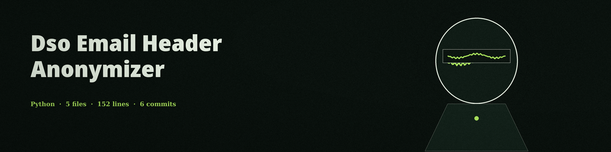

# dso-email-header-anonymizer
Removes or replaces identifying information from email headers to protect sender and recipient privacy. It handles Received, X-Mailer, Message-ID, Date, From, To, Cc, Bcc, Sender, X-Original-From, and Reply-To headers. Other headers and the message body pass through unchanged.

## Install
`git clone https://github.com/ShadowGuard-AI/dso-email-header-anonymizer`
`pip install -r requirements.txt`

## Usage
`python main.py input.eml output.eml [--keep-x-mailer] [--obfuscate-received] [--log-level LEVEL]`

Behavior notes:
- Naming the input file as the output file is refused with exit 1, in any spelling of the same path, before any write. The input file is left unchanged.
- An input with no header and body separator, including an empty file, fails with exit 1, a plain error line, and no output file.
- If no headers are anonymized, for example a message holding only a Subject header, the run exits non-zero with a plain no headers anonymized line and writes no output.
- Folded header lines (continuation lines starting with a space or tab) are unfolded before handling, so identifying values on continuation lines, such as in a folded Received header, do not pass through.
- With --obfuscate-received, only the host, IP address, and email address tokens in a Received header are replaced. The header name and structure, such as from, by, with, and the date, are kept, so the result still parses as a Received header. Without it, Received headers are removed.

## Parameters
- `input_file`: Path to the input email file.
- `output_file`: Path to the output anonymized email file.
- `--keep-x-mailer`: Keep the X-Mailer header (default: remove it).
- `--obfuscate-received`: Obfuscate Received headers instead of removing them (default: remove).
- `--log-level`: Set the logging level.

## License
Copyright (c) ShadowStrikeHQ
